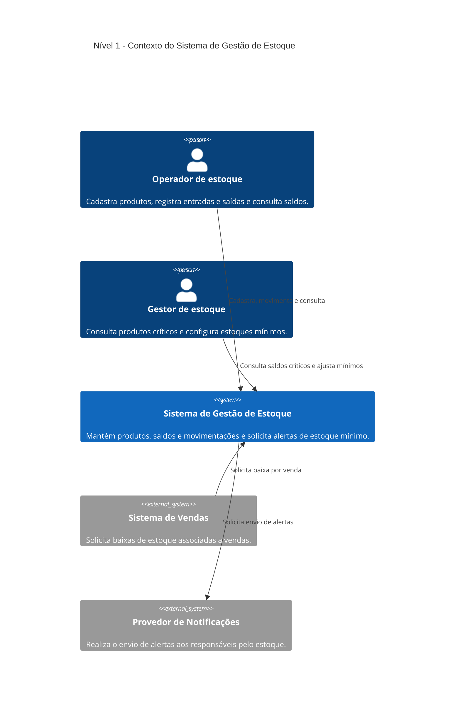

# Nível 1: Contexto do Sistema de Gestão de Estoque

> **Pergunta deste nível:** quem utiliza o sistema e com quais outros sistemas ele se relaciona?

O **System Context** é a visão mais ampla do [Modelo C4](https://c4model.com/diagrams/system-context). Ele apresenta o sistema de software sob análise, as pessoas que o utilizam e suas integrações externas. O público inclui pessoas de negócio, analistas, desenvolvedores e demais interessados. **Não é necessário conhecer .NET ou PostgreSQL para compreender este diagrama.**

Neste laboratório, o sistema central é o **Sistema de Gestão de Estoque**. Todos os elementos desenhados ao seu redor estão fora da sua fronteira.

## Diagrama de contexto

**Como interpretar:** as pessoas são apresentadas como `Person`; o software que estamos documentando é `System`; as duas integrações fora da nossa responsabilidade são `System_Ext`. As setas `Rel` indicam **quem inicia** cada interação e qual é seu propósito. O diagrama não afirma um protocolo, ordem de mensagens ou execução síncrona.

## Elementos e responsabilidades

| Elemento | Tipo C4 | O que faz | Fronteira |
| --- | --- | --- | --- |
| **Operador de estoque** | `Person` | Cadastra produtos, registra entradas/saídas e consulta saldo e histórico. | Pessoa que utiliza o sistema |
| **Gestor de estoque** | `Person` | Consulta saldos críticos e configura o estoque mínimo dos produtos. | Pessoa que utiliza o sistema |
| **Sistema de Gestão de Estoque** | `System` | Mantém os produtos, saldos e movimentações, controla as saídas e solicita alertas quando necessário. | **Sistema sob análise** |
| **Sistema de Vendas** | `System_Ext` | Solicita baixa vinculada a uma venda e informa a referência de origem para evitar duplicação da operação. | Sistema externo |
| **Provedor de Notificações** | `System_Ext` | Recebe solicitações de alerta e realiza a entrega aos destinatários. | Sistema externo |

A diferença entre **pessoa** e **sistema externo** é importante: a operação manual é uma interação humana; a baixa automática por venda é uma integração entre sistemas. O operador não está dentro do sistema de estoque só porque utiliza sua interface.

## Relações representadas

| Origem → destino | Finalidade | Requisito relacionado |
| --- | --- | --- |
| Operador de estoque → Sistema de Gestão de Estoque | Gerenciar produtos, movimentações e consultas. | RF-01 a RF-04 |
| Gestor de estoque → Sistema de Gestão de Estoque | Consultar itens críticos e ajustar os limites mínimos. | RF-05 e RF-07 |
| Sistema de Vendas → Sistema de Gestão de Estoque | Solicitar baixa de unidades associada a uma venda, com referência de origem. | RF-03; RN-04 |
| Sistema de Gestão de Estoque → Provedor de Notificações | Solicitar o envio de alertas de estoque mínimo. | RF-06; RN-06 e RN-07 |

**Escopo da integração:** o estoque não processa pagamentos ou pedidos de venda; recebe somente a solicitação de baixa. Da mesma forma, ele não implementa a entrega de mensagens ao destinatário; solicita esse serviço ao provedor externo.

## O mesmo caso de uso em uma visão ampla

No [cenário transversal](escopo-funcional.md#5-cenário-transversal-saída-de-10-unidades), o produto `SKU-001` começa com **15 unidades** e estoque mínimo de **5**:

1. O **operador** ou o **sistema de vendas** solicita a saída de **10 unidades** do **Sistema de Gestão de Estoque**.
2. O sistema aplica suas regras internamente e confirma a baixa, deixando **5 unidades**.
3. Como o saldo alcançou o mínimo, o sistema **solicita** o envio de um alerta ao **Provedor de Notificações**.
4. Uma repetição da mesma solicitação do sistema de vendas não produz uma segunda baixa, conforme a regra de idempotência.

Este resumo explica os **relacionamentos de negócio**, não a sequência técnica de execução: o processamento interno e a entrega assíncrona de alertas não aparecem nesta visão.

## O que deliberadamente não aparece

- **Aplicação Web, API ASP.NET Core, Worker .NET e PostgreSQL:** são contêineres internos do sistema, a serem revelados no **nível 2**.
- **Endpoints, HTTP, autenticação, tabelas e transações:** são detalhes de implementação; incluí-los aqui desviaria o foco da comunicação com públicos não técnicos.
- **Classes C#, repositórios e casos de uso:** serão tratados nos níveis 3 e 4.
- **Diagramas de sequência:** descrevem a ordem de interação e serão aprofundados na etapa 6.

A ausência desses detalhes **não** significa que eles não existam. O nível 1 apenas responde a uma pergunta diferente.

## Consistência com os próximos níveis

No nível 2, o `System` central deste diagrama será **ampliado** para revelar os seus contêineres internos. O **Sistema de Vendas** e o **Provedor de Notificações** permanecerão externos; o **Operador de estoque** e o **Gestor de estoque** continuarão sendo pessoas. As quatro relações conceituais aqui apresentadas devem ser atribuídas aos contêineres corretos, sem mudar a responsabilidade de cada participante.

**Próxima leitura:** [Arquitetura de referência](arquitetura-referencia.md) e [convenções do C4](guia-c4.md). A etapa 3 criará o capítulo `docs/02-containers.md`.

### Referências

- [C4 Model: System Context Diagram](https://c4model.com/diagrams/system-context)
- [Mermaid: C4 diagrams](https://mermaid.js.org/syntax/c4.html)
- [GitHub: Creating diagrams](https://docs.github.com/en/get-started/writing-on-github/working-with-advanced-formatting/creating-diagrams)
