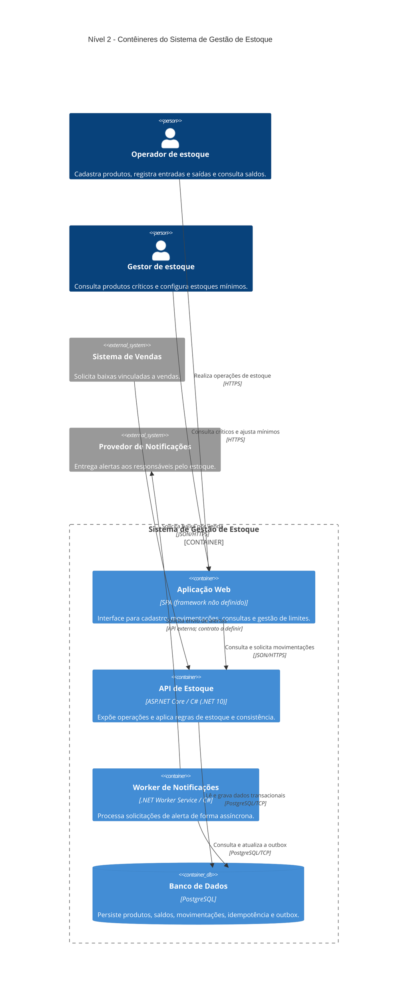

# Nível 2: Contêineres do Sistema de Gestão de Estoque

> **Pergunta deste nível:** quais aplicações e armazenamentos compõem o Sistema de Gestão de Estoque, quais são suas responsabilidades e como se comunicam?

O diagrama **Containers** amplia o [Sistema de Gestão de Estoque apresentado no nível 1](01-contexto.md). Em C4, um **contêiner** é uma aplicação executável ou um armazenamento de dados com responsabilidades próprias; **não significa necessariamente Docker**. Esta visão interessa especialmente a desenvolvedores, arquitetos, operações e pessoas que precisam entender a distribuição das responsabilidades, sem entrar em classes ou métodos.

O sistema permanece **didático e hipotético**: o diagrama documenta escolhas de referência, e não uma aplicação já implementada ou implantada. Consulte também a [visão correspondente em LikeC4](../likec4/visoes-contexto-conteineres.md#nível-2-contêineres-conteineres), derivada do mesmo modelo de arquitetura.

## Diagrama de contêineres

**Leitura rápida:** `Container_Boundary` marca a fronteira do mesmo sistema central do nível 1; `Container` indica aplicações executáveis; `ContainerDb` distingue o armazenamento. `Person` e `System_Ext` preservam os atores e integrações **fora** dessa fronteira.

O diagrama contém **quatro contêineres internos**, **duas pessoas**, **dois sistemas externos** e **sete relações direcionais**. Tecnologia indicada nos relacionamentos é um **contrato de referência**, não evidência de implementação. A interface externa de notificações permanece deliberadamente sem protocolo fechado.

## Contêineres internos e responsabilidades

| Contêiner | Tecnologia de referência | Responsabilidade principal | Não deve assumir |
| --- | --- | --- | --- |
| **Aplicação Web** | SPA, framework não definido | Oferecer cadastro de produtos, entrada/saída manual, consulta de saldos e configuração do mínimo. | Calcular o saldo autoritativo, validar concorrência ou gravar diretamente no banco. |
| **API de Estoque** | ASP.NET Core, C# / .NET 10 | Expor operações ao frontend e ao sistema de vendas; aplicar regras; garantir a transação de saldo, histórico, idempotência e criação da outbox. | Entregar notificações diretamente como parte da transação de baixa. |
| **Worker de Notificações** | .NET Worker Service / C# | Buscar itens pendentes da outbox, solicitar envios ao provedor e registrar tentativas/resultados. | Executar movimentações ou alterar saldos de produtos. |
| **Banco de Dados** | PostgreSQL | Persistir produtos, saldos, movimentações, referências externas e notificações pendentes. | Ser acessado diretamente pelo frontend ou pelo sistema de vendas. |

**Por que um worker separado?** O envio pode falhar, ser lento ou exigir novas tentativas. Separar o processamento impede que essa dependência externa faça parte da confirmação síncrona da movimentação. O worker consulta e atualiza **somente o estado operacional da outbox**; alterações de saldo e movimentações continuam sob responsabilidade exclusiva da API.

## Relações e mecanismos de comunicação

| Origem → destino | Para quê | Mecanismo ilustrativo |
| --- | --- | --- |
| Operador → Aplicação Web | Cadastrar, movimentar e consultar estoque. | Navegador, HTTPS |
| Gestor → Aplicação Web | Consultar itens críticos e configurar estoque mínimo. | Navegador, HTTPS |
| Aplicação Web → API de Estoque | Submeter operações e obter dados. | JSON/HTTPS |
| Sistema de Vendas → API de Estoque | Solicitar baixa com referência de origem idempotente. | JSON/HTTPS |
| API de Estoque → PostgreSQL | Consultar e persistir saldo, movimentações e outbox sob transação. | Protocolo PostgreSQL/TCP |
| Worker de Notificações → PostgreSQL | Buscar itens pendentes e registrar status/tentativas de envio. | Protocolo PostgreSQL/TCP |
| Worker de Notificações → Provedor de Notificações | Solicitar a entrega de alertas. | API externa, contrato a definir |

**Não existe uma chamada direta API → Worker neste desenho.** O mecanismo de comunicação **assíncrona** é a outbox persistida no PostgreSQL: a API insere a intenção de notificar na mesma transação da baixa; o worker consulta os registros pendentes posteriormente. Isso demonstra o padrão sem adicionar broker de mensagens.

As setas representam **dependência e iniciativa de comunicação**, não chamadas de retorno. Respostas de HTTP e de consultas SQL não ganham uma seta inversa apenas para mostrar o retorno.

## O caso de uso transversal visto pelos contêineres

O mesmo [cenário do nível 1](01-contexto.md#o-mesmo-caso-de-uso-em-uma-visão-ampla) continua: `SKU-001` tem **15 unidades** em estoque, mínimo **5**, e recebe uma saída de **10 unidades**.

1. O **Operador** solicita a baixa pela **Aplicação Web**, que chama a **API**. Alternativamente, o **Sistema de Vendas** chama diretamente a **API** com sua referência de origem.
2. A **API** aplica validações e, usando uma transação com proteção de concorrência no **PostgreSQL**, atualiza o saldo de **15 para 5** e grava o histórico.
3. Na **mesma transação**, a API registra um item de **outbox**, pois o saldo cruzou o limite mínimo (de acima de 5 para igual a 5).
4. Depois da confirmação transacional, a **API** responde ao solicitante. Uma repetição da mesma requisição externa não realiza uma nova baixa.
5. Em momento posterior, o **Worker** consulta a outbox no **PostgreSQL**, solicita envio ao **Provedor de Notificações** e registra o resultado ou uma nova tentativa.

Essa descrição indica **que contêiner faz o quê**. A ordem das mensagens, a separação entre commit e envio e os retries são detalhados no [fluxo de movimentação](fluxo-movimentacao.md).

### Consistência e falhas

- **Sem saldo negativo:** a verificação de disponibilidade deve fazer parte de uma operação transacional segura contra concorrência no banco. Uma leitura anterior, isolada, não basta.
- **Idempotência:** a referência da venda deve ter unicidade persistida, para impedir baixas duplicadas em retries concorrentes.
- **Atomicidade:** saldo, movimentação e criação da outbox devem ser confirmados ou revertidos juntos quando a baixa cruza o mínimo.
- **Notificações eventuais:** indisponibilidade do provedor **não** desfaz a baixa confirmada. Reenvios podem produzir entrega repetida; não há promessa de *exactly once*.
- **Fronteira compartilhada do banco:** API e worker usam o PostgreSQL por uma razão explícita (outbox), sem transformar o banco em API pública para sistemas externos.

O [catálogo de decisões](decisoes-arquiteturais.md) detalha especialmente os ADRs sobre monólito modular, banco transacional, worker, outbox, concorrência e idempotência. Esses ADRs permanecem **Proposed** até revisão e aprovação humana.

## O que este nível acrescenta e o que omite

| Perspectiva | Nível 1: Contexto | Nível 2: Contêineres |
| --- | --- | --- |
| Fronteira | Um único sistema de estoque. | O mesmo sistema ampliado, com quatro contêineres internos. |
| Operador e gestor | Interagem com o Sistema de Gestão de Estoque. | Interagem com a **Aplicação Web**. |
| Sistema de Vendas | Solicita baixa ao sistema. | Solicita baixa à **API de Estoque**. |
| Provedor de Notificações | Recebe solicitação de envio do sistema. | Recebe solicitação do **Worker de Notificações**. |
| Saldo, histórico e alertas | São responsabilidades internas abstratas. | API e PostgreSQL sustentam transações; worker entrega alertas com outbox. |

**Ainda não aparecem:** controllers, casos de uso, serviços de domínio, repositórios, entidades C#, índices SQL ou métodos. Esses detalhes cabem nos níveis **3 (Components)** e **4 (Code)**. Também não modelamos instâncias, nós de implantação, cluster, redes, nuvem ou escala horizontal: isso seria uma visão de *Deployment*, fora do escopo deste laboratório.

## Próximo zoom: nível 3

O [capítulo do nível 3: Componentes](03-componentes.md) abre **apenas o contêiner API de Estoque** para explicar suas partes internas: endpoints HTTP, casos de uso, domínio e infraestrutura. A **Aplicação Web**, o **PostgreSQL**, o **Worker** e o **Sistema de Vendas** continuarão visíveis como dependências externas **à API**, mas não passarão a ser componentes dela.

Para retomar a visão de negócio, leia o [nível 1: Contexto](01-contexto.md). Para compreender as escolhas técnicas, consulte a [arquitetura de referência](arquitetura-referencia.md) e o [guia C4](guia-c4.md).

### Referências

- [C4 Model: Container Diagram](https://c4model.com/diagrams/container)
- [Mermaid: C4 Diagrams](https://mermaid.js.org/syntax/c4.html)
- [GitHub: Criar diagramas em Markdown](https://docs.github.com/en/get-started/writing-on-github/working-with-advanced-formatting/creating-diagrams)
