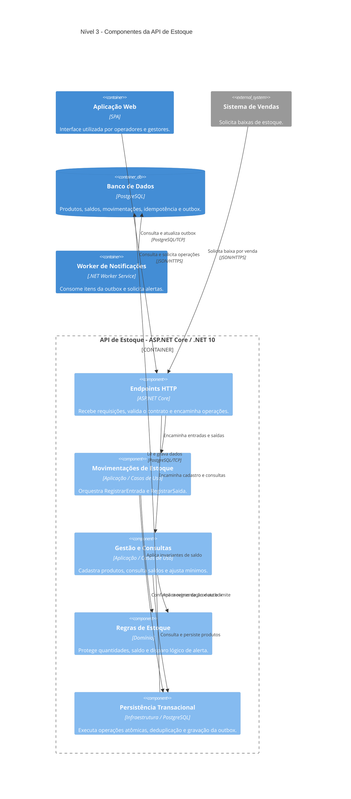

# Nível 3: Componentes da API de Estoque

> **Pergunta deste nível:** quais componentes existem **dentro da API de Estoque**, o que cada um faz e de quais outros componentes e contêineres depende?

No [Modelo C4](https://c4model.com/diagrams/component), o diagrama **Component** aprofunda **um contêiner de cada vez**. Após a visão do [nível 2 (Containers)](02-containers.md), este capítulo abre apenas a **API de Estoque (ASP.NET Core, C# / .NET 10)**. Os demais contêineres aparecem como colaboradores **externos à fronteira da API**, mesmo que pertençam ao mesmo sistema de gestão de estoque.

O objetivo continua sendo **explicar uma arquitetura hipotética**: não há serviços implantados, contratos HTTP publicados nem código executável. Aqui, *componente* significa um agrupamento coeso de responsabilidades de software, **não** uma classe C# nem, obrigatoriamente, um projeto ou um microsserviço.

## Diagrama de componentes

**Como ler:** a `Container_Boundary` contém **somente** os cinco componentes da API. `Container`, `ContainerDb` e `System_Ext` representam elementos fora da API; as setas `Rel` documentam dependências e a iniciativa de comunicação. As responsabilidades internas são **lógicas** e não significam chamadas de rede entre componentes. A direção `Persistência Transacional → PostgreSQL` representa acesso ao banco; a direção `Worker → PostgreSQL` torna explícito o consumo posterior da outbox, **sem** chamar diretamente a API.

O **Provedor de Notificações** não aparece neste nível porque **nenhum componente da API se comunica diretamente com ele**. A integração é realizada pelo Worker, como mostrado no [nível 2](02-containers.md).

## Responsabilidades e fronteiras

| Componente da API | Responsabilidade | O que não deve fazer |
| --- | --- | --- |
| **Endpoints HTTP** | Receber solicitações da web e do Sistema de Vendas, interpretar contratos e encaminhar para os casos de uso; converter resultados em respostas. | Implementar regras de saldo ou realizar acesso SQL diretamente. |
| **Movimentações de Estoque** | Orquestrar `RegistrarEntrada` e `RegistrarSaida`, identificando origem e idempotência quando aplicável. | Alterar saldos fora da transação ou enviar notificações ao provedor. |
| **Gestão e Consultas** | Coordenar cadastro de produtos, consultas de saldo/histórico, consulta de críticos e atualização de estoque mínimo. | Validar saldo apenas na interface ou compartilhar estado mutável com o frontend. |
| **Regras de Estoque** | Aplicar quantidades positivas, proibição de saldo negativo e detecção de cruzamento do limite mínimo. | Depender de HTTP, PostgreSQL ou processamento de mensagens. |
| **Persistência Transacional** | Implementar os contratos de persistência usados pela aplicação, garantindo atomicidade, unicidade de origem e escrita de saldo, histórico e outbox. | Decidir se uma saída é permitida por regra de negócio ou entregar alertas. |

Os componentes são uma **decomposição funcional do monólito modular**. A separação em entrada, aplicação, domínio e infraestrutura é conceitual e não exige cinco assemblies, cinco serviços ou uma estrutura física de pastas específica.

### Dependências e direção arquitetural

A camada de aplicação **utiliza contratos/portas** de persistência; a infraestrutura fornece suas implementações. Assim, a seta lógica da aplicação para a Persistência Transacional significa **uso do serviço contratado**, não que o domínio precise referenciar um pacote do PostgreSQL.

No futuro exemplo C#, a implementação poderá empregar interfaces definidas em uma camada interna e implementadas na infraestrutura. A resolução em runtime será configurada na composição da API. O diagrama do nível 3 **não é** um grafo de referências de assemblies; classes e interfaces concretas só serão detalhadas no [nível 4](guia-c4.md).

## O mesmo cenário: saída de 10 unidades

Considere o produto `SKU-001`, com **15 unidades** e **estoque mínimo 5**, conforme o [escopo funcional](escopo-funcional.md#5-cenário-transversal-saída-de-10-unidades).

1. A **Aplicação Web** ou o **Sistema de Vendas** envia uma requisição de baixa aos **Endpoints HTTP**. Para vendas, a origem inclui uma referência idempotente.
2. Os Endpoints encaminham a operação para **Movimentações de Estoque**, que coordena a solicitação e invoca as **Regras de Estoque** para validar quantidade, saldo e cruzamento do mínimo.
3. **Persistência Transacional** aplica a operação em uma **transação protegida contra concorrência**, no **PostgreSQL**. Registra a saída, atualiza o saldo de **15 para 5**, assegura a referência externa única e grava a intenção de alerta na **outbox**, tudo sob a mesma fronteira de confirmação.
4. Após a confirmação, **Movimentações de Estoque** devolve o resultado aos **Endpoints HTTP**, que respondem ao solicitante. Uma repetição idêntica da operação externa deve recuperar o resultado já registrado **sem novo débito**.
5. Posteriormente, o **Worker de Notificações**, que **não pertence à API**, consulta os registros de outbox no PostgreSQL e solicita a entrega ao provedor externo. O resultado do envio não participa da transação original.

**Leitura importante:** a validação de domínio por si só **não** impede uma corrida entre duas saídas simultâneas. A proteção efetiva do saldo deve ser garantida pela operação de persistência, por exemplo com atualização condicional ou bloqueio transacional e tratamento de conflito. Essa estratégia concreta será explicitada no nível 4.

### Cenários alternativos que os componentes devem suportar

| Cenário | Resultado exigido | Responsabilidades |
| --- | --- | --- |
| Saldo inicial 8, saída de 10 | Rejeitar sem alterar saldo, histórico ou outbox. | Regras de Estoque + Persistência Transacional. |
| Duas baixas concorrentes de 10 sobre saldo 15 | No máximo uma baixa deve ser concluída; saldo nunca negativo. | Persistência Transacional protege concorrência; aplicação interpreta o resultado. |
| Mesmo identificador de venda reenviado | Não repetir a movimentação. | Movimentações coordena; Persistência aplica unicidade transacional. |
| Saldo 15 → 5 com mínimo 5 | Registrar **um evento lógico de cruzamento** na outbox na transação da baixa. | Regras detecta cruzamento; Persistência grava a intenção. |
| Provedor de notificações indisponível | Baixa permanece confirmada; envio é tentado posteriormente. | Worker e outbox (fora da execução síncrona da API). |

A configuração de autenticação, tratamento global de erros, observabilidade e outras preocupações transversais é relevante em projetos reais, mas foi omitida do desenho para não transformar um exercício de C4 em um blueprint de produção.

## Rastreabilidade entre os níveis

| Nível 2: relação com a API | Nível 3: detalhe correspondente |
| --- | --- |
| Aplicação Web → API de Estoque | Aplicação Web → **Endpoints HTTP**. |
| Sistema de Vendas → API de Estoque | Sistema de Vendas → **Endpoints HTTP**. |
| API de Estoque → PostgreSQL | **Persistência Transacional** → PostgreSQL. |
| Worker de Notificações → PostgreSQL | Relação preservada fora da API, para processamento da **outbox**. |
| Worker de Notificações → Provedor de Notificações | Mantida no nível 2; o provedor não é dependência dos componentes da API. |

| Requisitos e decisões da etapa 1 | Componentes que os sustentam |
| --- | --- |
| RF-01 a RF-07: cadastro, movimentações, consultas, mínimos e alerta | Endpoints HTTP, Movimentações, Gestão e Consultas, Regras e Persistência. |
| RN-01, RN-02, RN-05: quantidades, saldo e concorrência | Regras de Estoque + Persistência Transacional. |
| RN-03, RN-04: histórico e idempotência | Movimentações + Persistência Transacional. |
| RN-06, RN-07: cruzamento do mínimo e alerta eventual | Regras + Persistência (outbox), consumida pelo Worker. |

As decisões de referência seguem registradas como **Proposed**, especialmente [ADR 0001](adr/0001-adotar-monolito-modular.md), [ADR 0003](adr/0003-adotar-postgresql-transacional.md), [ADR 0005](adr/0005-adotar-outbox-sem-broker.md), [ADR 0006](adr/0006-proteger-concorrencia-no-saldo.md) e [ADR 0007](adr/0007-exigir-idempotencia-em-baixas-externas.md). Este diagrama não cria novas decisões; apenas explicita as responsabilidades já propostas.

## Próximo zoom: nível 4 (Code)

O [nível 4: Código](04-codigo.md) documenta, com `classDiagram` e pequenos exemplos C#, **um recorte** da operação `RegistrarSaida`, mostrando:

- o caso de uso que orquestra a baixa;
- os objetos de domínio que aplicam invariantes do saldo;
- as interfaces de persistência consumidas pela aplicação;
- os registros de movimentação, referência de origem e outbox, com limites transacionais claros.

Os nomes concretos de classes, assinaturas de métodos e um mecanismo ilustrativo de concorrência estão no [capítulo de código](04-codigo.md), não neste diagrama de componentes. Não haverá implementação integral da aplicação.

**Voltar:** [nível 2: Contêineres](02-containers.md) · [nível 1: Contexto](01-contexto.md) · [guia C4 e Mermaid](guia-c4.md).

### Referências

- [C4 Model: Component Diagram](https://c4model.com/diagrams/component)
- [Mermaid: C4 Diagrams](https://mermaid.js.org/syntax/c4.html)
- [GitHub: Diagramas em Markdown](https://docs.github.com/en/get-started/writing-on-github/working-with-advanced-formatting/creating-diagrams)
