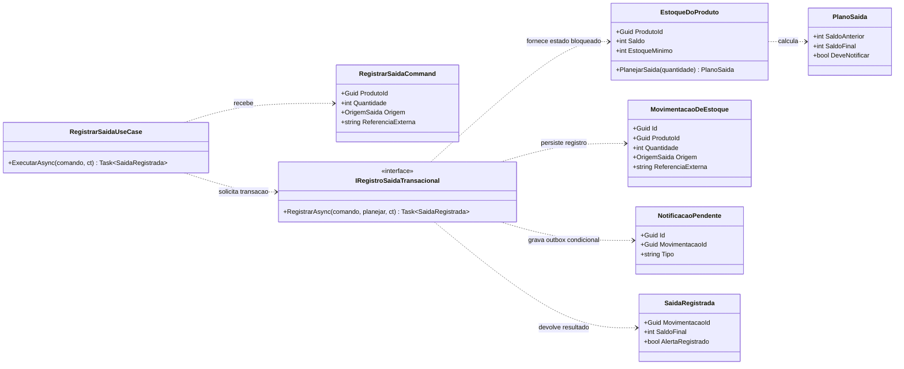

# Nível 4: Código do caso de uso RegistrarSaida

> **Pergunta deste nível:** quais classes, contratos e objetos de domínio concretizam o registro de uma saída de estoque?

O nível 4 do [Modelo C4](https://c4model.com/diagrams/code) é um **zoom opcional no código de um componente**, voltado a pessoas que desenvolvem e revisam a implementação. Neste laboratório, o recorte é a operação **`RegistrarSaida`**, pertencente ao componente **Movimentações de Estoque** do [nível 3](03-componentes.md). Mostramos apenas seus objetos mais relevantes e os contratos com domínio e persistência.

O Mermaid não oferece um tipo `C4Code`; portanto, usamos `classDiagram` como **representação UML complementar do nível 4**, e não como uma extensão C4 nativa. O desenho é **ilustrativo**: o projeto continua sem API executável, banco provisionado ou worker implantado.

O [zoom da API em LikeC4 (nível 3)](../likec4/visao-componentes.md) apresenta os cinco componentes que colaboram com este caso de uso. O nível 4 mantém **UML de classes no Mermaid**, sem tentar representar assinaturas C# como componentes arquiteturais.

## Diagrama de classes

**Convenções:** setas tracejadas (`..>`) indicam **dependência/uso**, não herança; `<<interface>>` identifica uma porta de persistência; a anotação `Task~SaidaRegistrada~` é a notação Mermaid para um tipo genérico. No C# ilustrativo, `ReferenciaExterna` é **anulável** para operações manuais e obrigatória para solicitações do Sistema de Vendas. O diagrama simplifica a nulabilidade para manter a leitura.

O **centro do zoom** é `RegistrarSaidaUseCase`. Os objetos de domínio e a interface de persistência são **colaboradores imediatos**, não uma tentativa de desenhar todas as classes dos componentes vizinhos. Não modelamos `Controller`, `DbContext`, `Worker`, consultas ou implementações de UI. A implementação da porta no PostgreSQL é descrita em texto, pois sua estrutura completa não pertence ao recorte.

## Mapeamento: do componente às classes

| Elemento do nível 3 | Papel no nível 4 |
| --- | --- |
| **Endpoints HTTP** | Constrói `RegistrarSaidaCommand` e chama `RegistrarSaidaUseCase`; endpoint concreto omitido. |
| **Movimentações de Estoque** | `RegistrarSaidaUseCase` orquestra a operação e depende da porta `IRegistroSaidaTransacional`. |
| **Regras de Estoque** | `EstoqueDoProduto.PlanejarSaida` valida a quantidade, rejeita saldo insuficiente e produz `PlanoSaida`. |
| **Persistência Transacional** | Implementa a porta, controla transação e bloqueio, grava `MovimentacaoDeEstoque`, saldo e `NotificacaoPendente`. |
| **Worker de Notificações (nível 2)** | Lê a outbox posteriormente; não aparece como classe dentro da API. |

A interface `IRegistroSaidaTransacional` pertence à **abstração consumida pela aplicação**. Sua implementação concreta usa PostgreSQL na infraestrutura; o domínio não importa SQL ou bibliotecas de persistência. A função `planejar` é invocada **com o saldo carregado sob proteção transacional** e devolve um plano que a implementação persiste atomicamente. O diagrama expõe uma colaboração entre componentes, mas **não afirma dependências físicas entre assemblies**.

## Exemplo C#: contratos e regra de negócio

O [exemplo anotado de `RegistrarSaida`](../examples/registrar-saida.md) contém somente os tipos necessários para explicar esta colaboração:

- `RegistrarSaidaCommand` informa produto, quantidade, origem e referência externa opcional para operações manuais.
- `RegistrarSaidaUseCase` verifica a referência obrigatória para vendas e delega o trabalho transacional à porta.
- `EstoqueDoProduto.PlanejarSaida` calcula o plano **a partir de um saldo já protegido**, sem acessar infraestrutura.
- `PlanoSaida` informa saldo anterior, saldo final e cruzamento do limite mínimo.
- `SaidaRegistrada`, `MovimentacaoDeEstoque` e `NotificacaoPendente` representam resultado, histórico e intenção de alerta.

Os trechos são **C# ilustrativo**, sem dependências externas, e **não representam um programa executável**: não existe aqui implementação da porta, composição de dependências, endpoint, integração com PostgreSQL nem testes automatizados. O objetivo é compreender responsabilidades, não distribuir um produto.

## Por que a operação precisa de uma transação real

O cálculo no domínio **não garante concorrência sozinho**. Um plano feito com o saldo antigo pode se tornar obsoleto caso outra saída seja confirmada antes da gravação. A implementação de `IRegistroSaidaTransacional` deve, portanto, garantir a seguinte sequência conceitual dentro de **uma única transação PostgreSQL**:

1. Identificar repetições de operações externas por `(Origem, ReferenciaExterna)`. Uma chave repetida com payload **diferente** é um conflito, não uma nova baixa válida.
2. Bloquear o registro do estoque do produto (por exemplo, `SELECT ... FOR UPDATE`) **antes** de carregar o estado usado pelo domínio; sob `READ COMMITTED`, repetir a consulta de idempotência após obter o bloqueio evita um resultado obsoleto para a mesma operação/produto.
3. Aplicar `EstoqueDoProduto.PlanejarSaida` sobre o estado bloqueado. Se a quantidade for inválida ou não houver saldo, rejeitar a operação sem mutação persistida.
4. Atualizar saldo e gravar `MovimentacaoDeEstoque` com a referência externa e restrição única no banco; se `DeveNotificar` for verdadeiro, gravar também `NotificacaoPendente`.
5. **Confirmar tudo ou desfazer tudo**: atualizar saldo, registrar a movimentação e criar a outbox na mesma transação. Retornar `SaidaRegistrada` **depois do commit**.
6. Se houver conflito de unicidade entre requisições simultâneas que usaram a mesma referência externa, desfazer a transação perdedora, reler o registro vencedor e verificar se seus dados correspondem à solicitação original antes de devolver seu resultado.

Essa estratégia é **um desenho de referência**, não SQL de produção. A especificação de índices, isolamento, tratamento de falhas e retries está documentada em [consistência e idempotência](../examples/persistencia-transacional.md).

**Observação:** o comportamento idempotente de uma baixa **confirmada** está definido. A política de retenção de chaves e de reapresentação de rejeições (por exemplo, saldo insuficiente) não faz parte desta etapa e precisaria ser decidida antes de uma implementação real.

## Cenário transversal: 15 → 5

Para `SKU-001`, saldo inicial **15**, estoque mínimo **5** e solicitação de saída **10**:

| Passo | Objeto / colaboração | Resultado |
| --- | --- | --- |
| Receber requisição | `RegistrarSaidaCommand` | Produto, quantidade 10, origem e referência quando aplicável. |
| Coordenar transação | `RegistrarSaidaUseCase` → `IRegistroSaidaTransacional` | O saldo será lido sob bloqueio transacional. |
| Aplicar regra | `EstoqueDoProduto.PlanejarSaida(10)` | `PlanoSaida(15, 5, DeveNotificar: true)`. |
| Persistir operação | Implementação da porta no PostgreSQL | Saldo 5, movimentação e item da outbox na mesma transação. |
| Responder | `SaidaRegistrada` | Id da movimentação, saldo 5 e alerta **registrado** (não necessariamente enviado). |
| Enviar alerta | Worker (nível 2) | Entrega eventual a um provedor externo. |

O resultado `AlertaRegistrado` significa que **a intenção foi confirmada na outbox**, não que o destinatário recebeu a mensagem.

### Cenários de falha e invariantes

| Entrada ou situação | Resultado esperado |
| --- | --- |
| Quantidade zero ou negativa | Rejeição antes de movimentar saldo. |
| Saldo 8, tentativa de retirar 10 | Rejeição; nenhuma movimentação ou outbox confirmada. |
| Duas saídas distintas de 10 sobre saldo 15 | Apenas uma baixa confirmada; a outra falha por saldo insuficiente. |
| Repetição da mesma venda com mesma referência e dados | Resultado da baixa já confirmada, **sem novo débito**. |
| Mesma referência externa reutilizada com quantidade/produto diferente | Conflito de identidade; não realizar outra baixa. |
| Saldo 15 → 5, mínimo 5 | Um registro lógico de outbox de alerta de cruzamento do mínimo. |
| Falha no provedor de notificações | Baixa continua confirmada e o worker tenta posteriormente. |

## O que foi deliberadamente omitido

Não há classes para a aplicação web, o worker, o provedor externo, a modelagem completa de produtos, frameworks de acesso a dados, parâmetros de deployment ou cada comando/consulta do sistema. Uma visão completa de classes perderia o **propósito didático** do zoom e ficaria obsoleta rapidamente.

No nível 4, a leitura do **contrato e suas invariantes** importa mais que a quantidade de classes desenhadas. O [Modelo C4 trata esse nível como opcional](https://c4model.com/diagrams/code), e a representação pode ser regenerada por IDEs em sistemas reais.

## Próxima etapa

O [fluxo de movimentação](fluxo-movimentacao.md) (etapa 6) apresenta as interações em sequência, distinguindo **transação síncrona**, **confirmação ao solicitante** e **envio eventual de notificações**, com cenários de falha e ADRs aprofundados.

**Voltar:** [nível 3: Componentes](03-componentes.md) · [nível 2: Contêineres](02-containers.md) · [nível 1: Contexto](01-contexto.md) · [índice da documentação](README.md).

### Referências

- [C4 Model: Code Diagram](https://c4model.com/diagrams/code)
- [Mermaid: Class diagrams](https://mermaid.js.org/syntax/classDiagram.html)
- [ADR Guard: validação das decisões](decisoes-arquiteturais.md)
