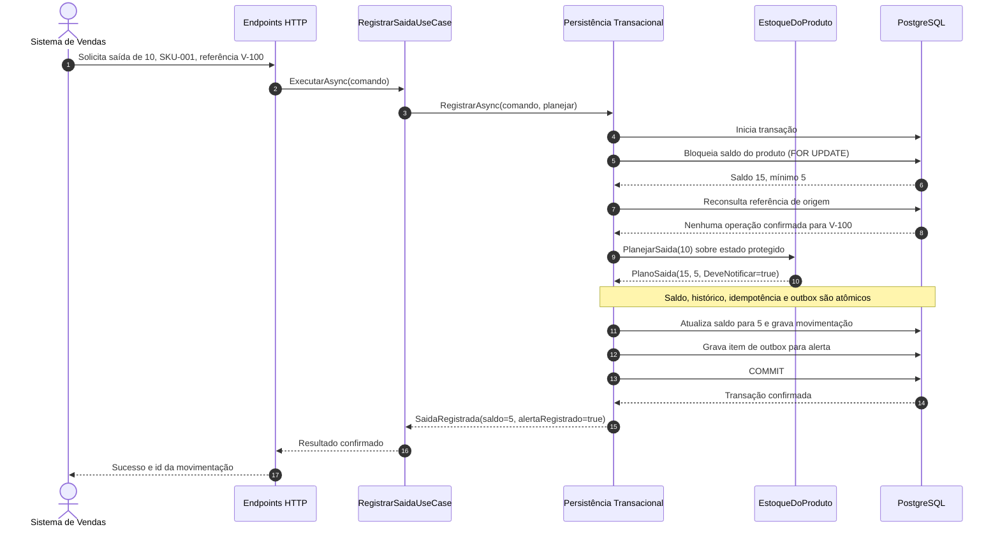
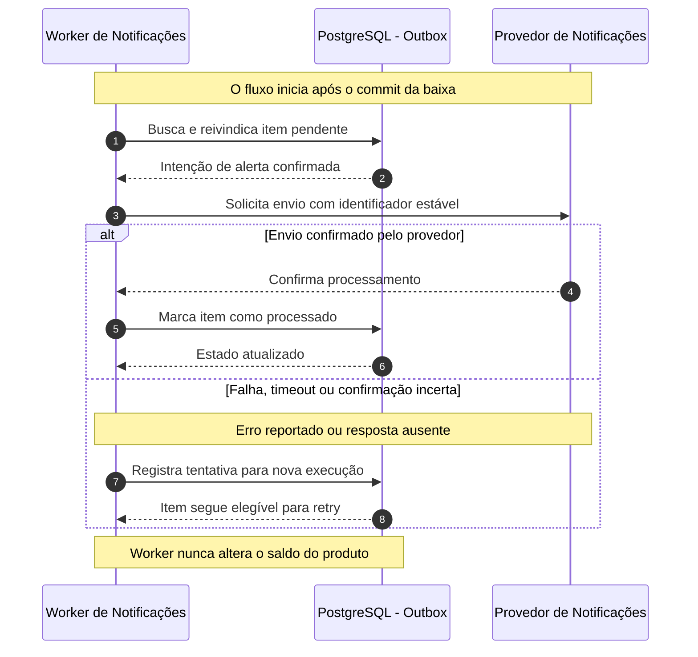

# Fluxo de movimentação: confirmação e alerta

> **Pergunta:** em qual ordem os elementos colaboram para registrar uma baixa, manter o saldo consistente e solicitar um alerta posteriormente?

Este capítulo é uma **visão dinâmica complementar**, não um quinto nível C4. O [equivalente em LikeC4](../likec4/fluxos-dinamicos.md) reutiliza os participantes do modelo arquitetural compartilhado para representar a baixa síncrona e o processamento posterior da outbox. Usamos `sequenceDiagram` do Mermaid para explicar o comportamento em execução do caso `RegistrarSaida`, cuja estrutura está documentada nos níveis [1](01-contexto.md), [2](02-containers.md), [3](03-componentes.md) e [4](04-codigo.md).

**Cenário transversal:** o produto `SKU-001` possui **15 unidades**, estoque mínimo de **5**, e o Sistema de Vendas solicita a baixa de **10 unidades**, com chave de origem estável `V-100`.

## 1. Baixa síncrona e confirmação transacional

**Fronteira de atomicidade:** uma transação PostgreSQL protege o estado do produto, garante unicidade de origem e inclui saldo, movimentação e eventual outbox. A API responde **após o commit**. Não existe chamada da API ao provedor de notificações ou ao worker durante a baixa.

O `EstoqueDoProduto` **não acessa o banco**. Sua regra `PlanejarSaida` calcula `PlanoSaida` a partir do saldo que a implementação de `IRegistroSaidaTransacional` carregou **sob proteção transacional**. Somente esse adaptador aplica o plano e persiste as alterações. Consulte o [exemplo C#](../examples/registrar-saida.md) e o [contrato de persistência](../examples/persistencia-transacional.md).

**Variante manual:** o Operador registra a saída na Aplicação Web, que chama os mesmos Endpoints HTTP. Não há chave externa obrigatória nessa modalidade. O processamento de domínio e a fronteira transacional permanecem iguais.

## 2. Entrega eventual pela outbox

O **Worker de Notificações** é um contêiner separado da API, como no [nível 2](02-containers.md). O segundo diagrama retrata uma tentativa de entrega **após a confirmação da movimentação**.

**Consistência eventual:** o saldo já está confirmado em **5**, mesmo que o provedor esteja indisponível. `AlertaRegistrado=true` significa **intenção gravada na outbox**, não mensagem entregue. Em um timeout, o provedor pode ter recebido a mensagem sem conseguir confirmar a resposta; por isso **pode haver reenvio**. Um identificador estável ajuda a deduplicar apenas se o provedor oferecer essa capacidade. Não há garantia de *exactly once*.

Uma implementação com vários workers precisaria reivindicar itens de forma concorrência-segura (por exemplo, com mecanismo de claim/lease). O diagrama não define o algoritmo nem simula a execução de um worker real.

## 3. Caminhos alternativos

| Situação | Resultado esperado | Invariante preservada |
| --- | --- | --- |
| Saldo 15, baixa 10, mínimo 5 | Saldo 5, movimentação confirmada e **uma** outbox. | RN-02, RN-03, RN-06 |
| Quantidade zero ou negativa | Rejeição sem escrita. | RN-01 |
| Saldo 8, baixa 10 | Rejeição e rollback, sem movimentação/outbox. | RN-02 |
| Duas baixas **distintas** de 10 sobre saldo 15 | Uma confirma; a segunda, após obter o lock e ler saldo 5, é rejeitada. | RN-05 |
| Reenvio da mesma venda e mesmo payload | Recupera o resultado já confirmado, **sem nova baixa/outbox**. | RN-04 |
| Mesma chave com outro produto ou quantidade | Conflito de identidade, sem nova baixa. | RN-04 |
| Duas requisições concorrentes usando a mesma chave | Checagem de duplicidade **após o lock**, restrição única e tratamento de conflito entre transações. | RN-04, RN-05 |
| Estoque já em 5, saída 1 | Saldo 4, sem novo alerta de **cruzamento**. | RN-06 |
| Falha ao inserir outbox antes de confirmar | Rollback de saldo, histórico e referência. | RN-07 |
| Provedor falha após confirmação | Saldo permanece confirmado; worker retenta. | RN-07 |
| Provedor envia, mas confirmação se perde | Reenvio é possível; deduplicação depende do contrato externo. | Repetição possível; não há garantia de entrega única |

**Concorrência e idempotência são problemas distintos.** A proteção de saldo impede duas **operações diferentes** de consumirem o mesmo estoque; a unicidade de `(Origem, ReferenciaExterna)` impede que a **mesma operação externa** seja registrada duas vezes. Uma consulta prévia de referência não basta sob concorrência. Mesmo com reconsulta após o bloqueio do produto, o banco deve impor a restrição única, inclusive quando a mesma chave é disputada em produtos diferentes. Se houver violação de unicidade, a transação perdedora faz rollback e consulta o registro vencedor para comparar os dados.

A implementação ilustrativa admite `READ COMMITTED` com `SELECT ... FOR UPDATE`; não propõe como resolvidas a retenção de chaves, a idempotência de operações rejeitadas, o tratamento de dead-letter ou os limites de retry. Esses requisitos e seus testes seriam necessários em uma aplicação real.

## 4. Rastreabilidade com os ADRs

| ADR | Ponto do fluxo | Consequência |
| --- | --- | --- |
| [0003: PostgreSQL](adr/0003-adotar-postgresql-transacional.md) | Transação atômica de saldo, movimentação, chave de origem e outbox. | Dependência crítica do banco. |
| [0004: Worker](adr/0004-separar-worker-de-notificacoes.md) | Processamento posterior à resposta da API. | Operação independente e observabilidade adicional. |
| [0005: Outbox](adr/0005-adotar-outbox-sem-broker.md) | Intenção persistida com a movimentação, sem broker. | Polling, retries e duplicações potenciais. |
| [0006: Concorrência](adr/0006-proteger-concorrencia-no-saldo.md) | Bloqueio antes de `PlanejarSaida`. | Contenção por produto; testes reais necessários. |
| [0007: Idempotência](adr/0007-exigir-idempotencia-em-baixas-externas.md) | Chave única e reapresentação segura do resultado. | Conflitos explícitos de payload divergente. |

Todos os ADRs permanecem **Proposed**. A documentação e o ADR Guard não representam aprovação nem comprovação de execução.

## 5. Como o fluxo se conecta aos quatro níveis

- **Contexto:** Sistema de Vendas inicia a baixa; Sistema de Estoque solicita alertas.
- **Contêineres:** Vendas → API → PostgreSQL; Worker → PostgreSQL e → Provedor.
- **Componentes:** Endpoints → Movimentações de Estoque → Regras/Persistência; worker fora da API.
- **Código:** `RegistrarSaidaUseCase` → `IRegistroSaidaTransacional` → `EstoqueDoProduto.PlanejarSaida`; `SaidaRegistrada` após commit.

Esta visão **temporal** complementa os quatro níveis, sem acrescentar outro contêiner, fila ou microsserviço. O próximo passo é a **etapa 7**, dedicada à validação automatizada de diagramas, revisão de links e preparação da versão `v1.0.0`.

### Referências

- [C4 Model: Dynamic Diagram](https://c4model.com/diagrams/dynamic)
- [Mermaid: Sequence Diagrams](https://mermaid.js.org/syntax/sequenceDiagram.html)
- [Guia C4 e Mermaid](guia-c4.md)
